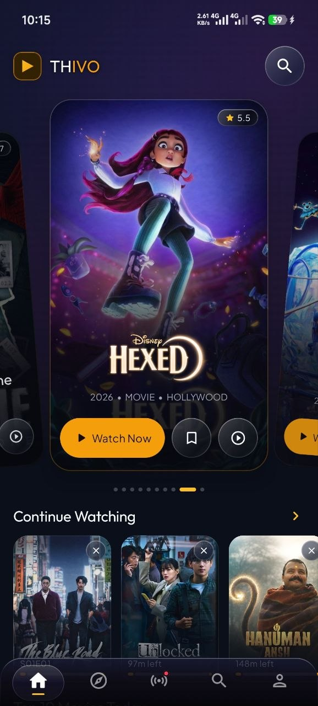
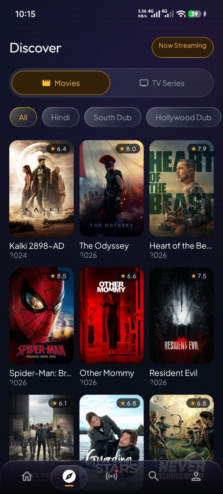
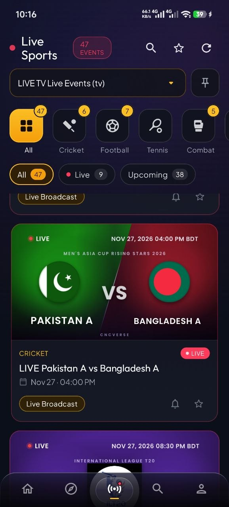
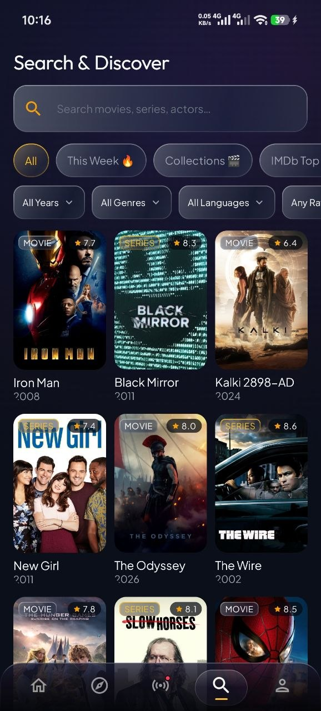
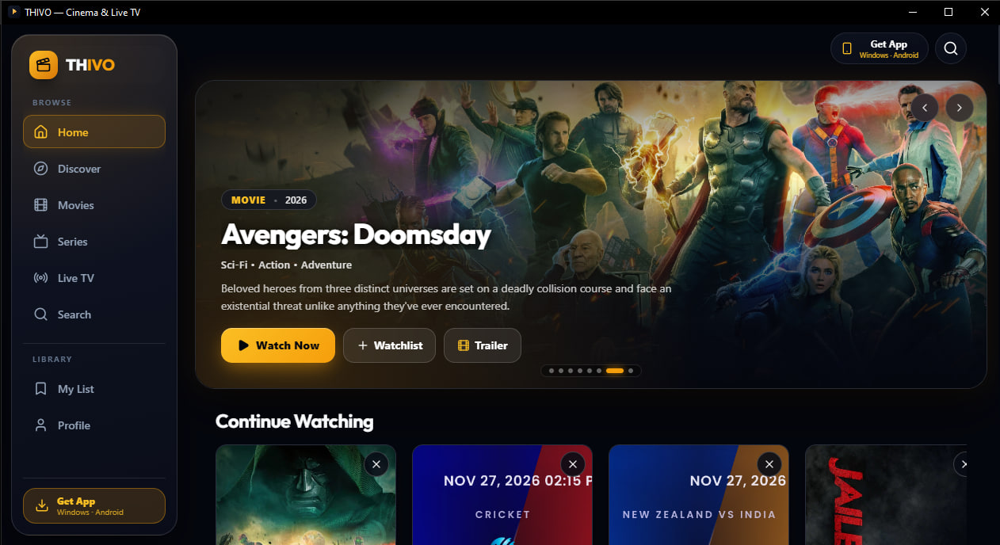
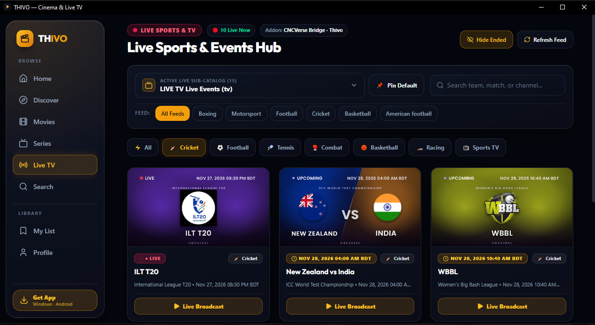

 

 

  

 

  

 

  
  &nbsp;
  
  &nbsp;
  

 

  
  

 

### YOUR ENTERTAINMENT. ONE EXPERIENCE.

A modern entertainment platform designed to bring your cinema experience to every screen.

 

[Highlights](#-highlights) · [Screenshots](#-screenshots) · [Android Features](#-android-experience) · [Windows Features](#-windows-experience) · [Add-ons](#-add-on-support)

---

## ✦ Highlights

<table>
<tr>
<td width="50%">

### ◈ Discover

Explore trending movies, TV series, and curated collections with an intuitive discovery experience.

</td>
<td width="50%">

### ◈ Your Sources

Connect compatible Stremio add-ons and manage your preferred streaming sources in one place.

</td>
</tr>
<tr>
<td width="50%">

### ◈ Cinema Player

Enjoy smooth playback across popular video formats with easy audio and subtitle switching.

</td>
<td width="50%">

### ◈ Subtitles

Find subtitles and customize their size, appearance, and timing to match your preferences.

</td>
</tr>
<tr>
<td width="50%">

### ◈ Live Sports

Explore and watch live sports and events directly inside THIVO.

</td>
<td width="50%">

### ◈ Smart Tools

Get optional AI-powered subtitle assistance whenever you need it.

</td>
</tr>
</table>

---

## ✦ Screenshots

A closer look at the THIVO experience across different screens.

### Android Experience

  
  
  
  

### Windows Experience

  
  

---

## ✦ Android Experience

**Entertainment built for your pocket and your living room.**

<strong>Discover & Explore</strong>

- Browse trending movies and TV series.
- Explore curated categories and collections.
- Discover entertainment through an intuitive interface.
- Search for your favourite movies and shows.

<strong>Universal Android Support</strong>

- Designed for Android Phones and Tablets.
- Supports Android TV and Google TV.
- Big-screen friendly interface.
- Full TV remote navigation support.
- One universal app for multiple Android screen types.

<strong>Streaming & Playback</strong>

- Smooth playback across popular video formats.
- Multiple audio language support.
- Subtitle selection and customization.
- Compatible third-party streaming source integration.

<strong>Live Sports & Smart Tools</strong>

- Watch live sports and events directly inside THIVO.
- Access optional AI-powered subtitle assistance.
- Manage your preferred streaming sources.

---

## ✦ Windows Experience

**A refined desktop entertainment experience.**

<strong>Built-in Cinema Player</strong>

- Watch Movies, TV Series, and Live TV.
- Smooth playback across popular video formats.
- Quick audio language switching.
- Subtitle selection and customization.
- Convenient playback controls.

<strong>Performance & Experience</strong>

- Faster application startup.
- Optimized playback experience.
- Reduced unnecessary resource usage.
- Smoother fullscreen transitions.
- Clean interface designed for desktop screens.

<strong>Clean Player Controls</strong>

- Play / Pause.
- Skip forward and backward by 10 seconds.
- Volume control.
- Fullscreen mode.
- Auto-hiding on-screen controls.

<strong>Flexible Installation</strong>

- **Installer Edition:** Standard Windows installation.
- **Portable Edition:** Run THIVO without installing it.
- Available for 64-bit Windows systems.

---

## ✦ Platforms

**One platform. Multiple screens. One seamless experience.**

| Platform | Edition | Experience |
|:--|:--|:--|
| **Android Phone & Tablet** | Universal App | One download for almost all Android phones and tablets. |
| **Android TV & Google TV** | Universal App | Big-screen friendly layout with full TV remote support. |
| **Windows** | Desktop App | Standard Installer and ready-to-run Portable editions. |
| **Web** | Browser Edition | Stream through modern web browsers without installation. |

---

## ✦ Add-on Support

THIVO supports compatible third-party Stremio add-ons and custom streaming sources.

- Add new sources using add-on links.
- Manage and organize installed add-ons.
- Customize add-on preferences where supported.

### Third-Party Credits

THIVO acknowledges the independent developers and services behind third-party add-ons.

  
  
  

> **Note:** These are independent third-party services. Their availability, features, and content are managed solely by their respective providers.

---

## ✦ Disclaimer

> THIVO is an independent project and is not officially affiliated with Stremio or any third-party services listed above. Third-party add-ons, services, and content sources are provided or configured by their respective providers, and their availability or functionality may change without notice. Users are responsible for ensuring their use of third-party services complies with local laws and service terms.

---

 

 

Discover · Stream · Enjoy

  

Crafted with passion by <a href="https://github.com/Tawhid5">Tawhid</a>

